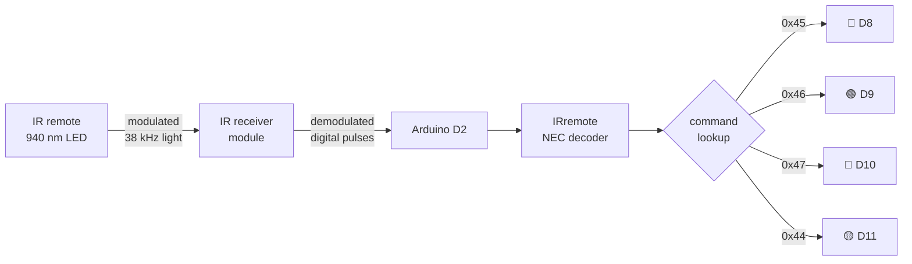
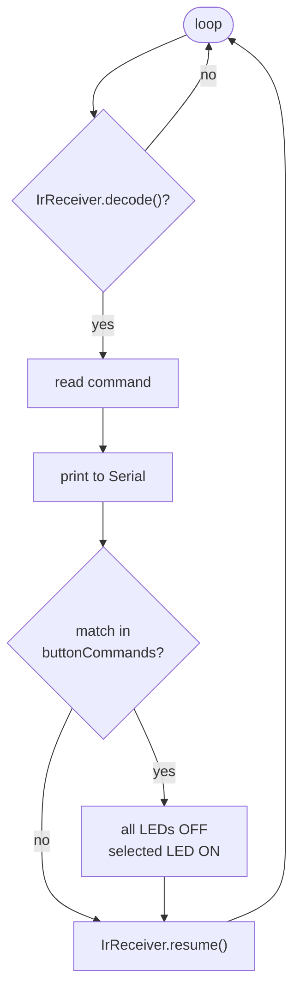

# 📡 Infrared Remote-Controlled LED System

> Using a standard TV-style remote to control an Arduino: an IR receiver demodulates the 38 kHz carrier, the IRremote library decodes the NEC frame, and each button command is mapped to an output.

---

## Contents
1. [Project Overview](#1-project-overview) · 2. [Objective](#2-objective) · 3. [Components](#3-components) · 4. [Working Principle](#4-working-principle) · 5. [Circuit Design](#5-circuit-design) · 6. [Implementation](#6-implementation) · 7. [Source Code](#7-source-code) · 8. [Results](#8-results) · 9. [Challenges](#9-challenges) · 10. [Future Improvements](#10-future-improvements)

---

## 1. Project Overview

Every TV remote is a small wireless transmitter. This project receives those signals, decodes which button was pressed, and turns on a matching LED, so a cheap remote becomes a wireless control panel for any Arduino project.

## 2. Objective

- Understand how data travels over infrared: modulation, carrier frequency, and pulse-distance encoding.
- Interface an IR receiver with a microcontroller.
- Decode remote commands and map buttons to functions.
- Write event-driven code that reacts to inputs instead of polling a fixed sequence.

## 3. Components

| Component | Role | Why |
|---|---|---|
| Arduino Uno | Controller | Reconstructed implementation |
| IR receiver module (e.g. VS1838B / TSOP38238) | Receives and demodulates the IR signal | Has a built-in 38 kHz band-pass filter and demodulator, so the Arduino sees clean digital pulses instead of raw light |
| IR remote (NEC protocol) | Transmitter | Common, cheap, well supported by the library |
| 4 × LED + 4 × 220 Ω | Outputs | |
| Breadboard, jumper wires | | |

## 4. Working Principle

### 4.1 Why 38 kHz?

Sunlight and room lighting contain plenty of infrared. If the remote just switched its LED on and off, the receiver couldn't tell button presses from the sun. So the remote **modulates** its IR LED at 38 kHz. The receiver module only responds to light flickering at that frequency, which filters out ambient IR almost entirely.

### 4.2 NEC frame

- Bits are encoded by the **length of the gap** after each 562 µs burst: short gap = 0, long gap = 1.
- The **inverted copies** (~Address, ~Command) let the receiver detect corrupted frames.
- Holding a button sends short **repeat codes** instead of the full frame.

The library handles all of this timing and gives a single 8-bit `command` value per button.

### 4.3 Software logic

## 5. Circuit Design

| Component | Arduino pin |
|---|---|
| IR receiver OUT | D2 |
| IR receiver VCC / GND | 5 V / GND |
| Red LED | D8 (via 220 Ω) |
| Green LED | D9 (via 220 Ω) |
| Blue LED | D10 (via 220 Ω) |
| Yellow LED | D11 (via 220 Ω) |

> ⚠️ **Check your module's pinout.** Bare VS1838B / TSOP receivers and breakout modules order OUT–GND–VCC differently, and swapping VCC and GND can destroy the sensor.
>
> **Reconstruction note:** Controller used in the reconstructed implementation: Arduino Uno. Pins are proposed, not confirmed original connections.

## 6. Implementation

1. Install **IRremote** (by Armin Joachimsmeyer et al.) from the Library Manager.
2. Wire only the receiver and upload the sketch.
3. Open the Serial Monitor at 9600 baud and press each button. **Write down the real command values for your remote.**
4. Put those values into `buttonCommands[]`.
5. Add the LEDs and test each button.

## 7. Source Code

📄 [`Code/ir_led_control/ir_led_control.ino`](Code/ir_led_control/ir_led_control.ino)

Key design choices:

| Choice | Reason |
|---|---|
| Lookup array `buttonCommands[]` | Adding a button means adding one value, with no new `if` branches |
| "All off, then one on" | Makes the LEDs mutually exclusive, like a selector switch |
| `IrReceiver.resume()` at the end | The receiver must be re-armed, or no further frames are captured |
| `ENABLE_LED_FEEDBACK` | The on-board LED blinks on every received frame, which helps when debugging |

### Button map

Fill this in from your own remote (step 3 above):

| Button | Command (hex) | Action |
|---|---|---|
| 1 | `0x45` | Red ON |
| 2 | `0x46` | Green ON |
| 3 | `0x47` | Blue ON |
| 4 | `0x44` | Yellow ON |

> These values are typical for the common 21-key "Car MP3" remote. They are illustrative until you check them on your own remote.

## 8. Results

- Each mapped button lights its LED and turns the others off.
- Every received command is printed to Serial, which makes adding new buttons easy.
- Unmapped buttons are ignored safely.

## 9. Challenges

- **Command values differ between remotes.** Even remotes that look the same can send different codes, so the codes have to be captured from the actual remote first.
- **Library API change.** Older tutorials use the IRremote 2.x API (`IRrecv irrecv(pin); decode(&results)`), which no longer compiles on version 4.x. This project uses the current `IrReceiver` API.
- **Repeat codes.** Holding a button produces repeat frames, which can re-trigger actions. A future version should ignore frames flagged as repeats.

## 10. Future Improvements

- [ ] An "all off" button and a mode-select button.
- [ ] Ignore repeat frames (`IRDATA_FLAGS_IS_REPEAT`).
- [ ] Show the received command on an OLED.
- [ ] Use PWM to make brightness up/down buttons.
- [ ] Capture the receiver output on an oscilloscope to show a real NEC frame.

## References

See [`References/`](References/).
